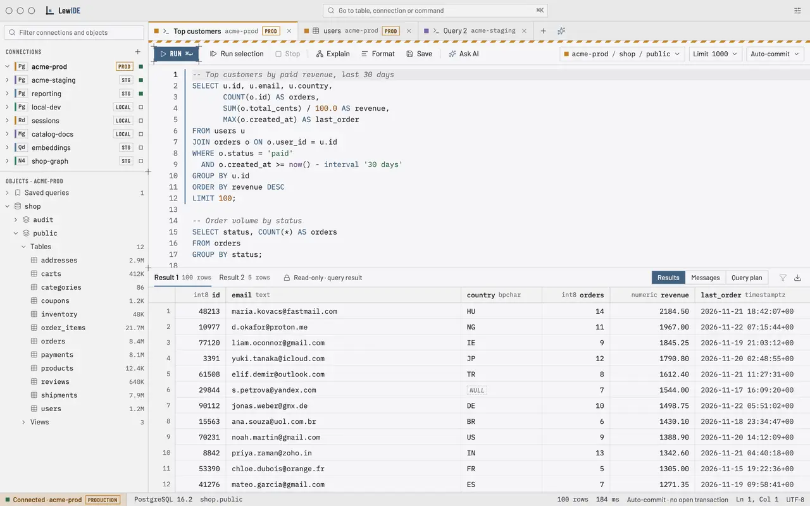
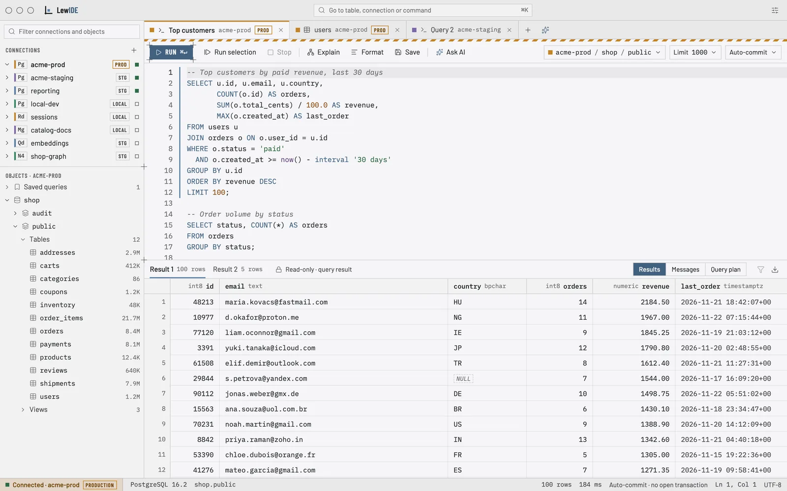
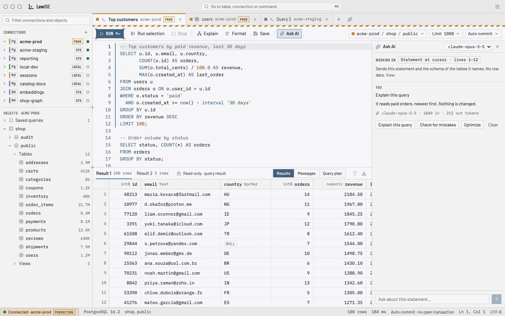
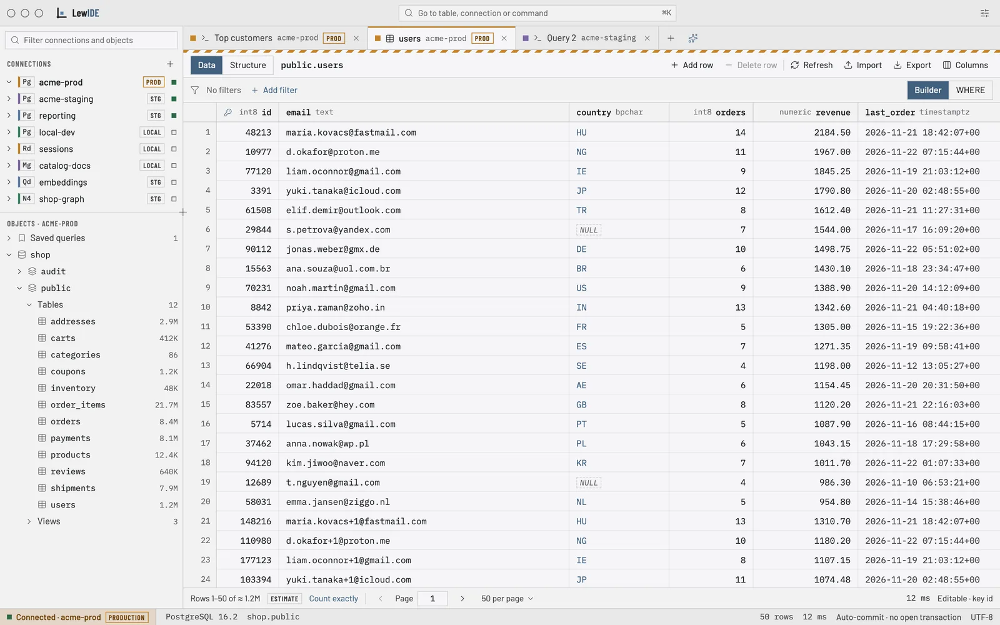
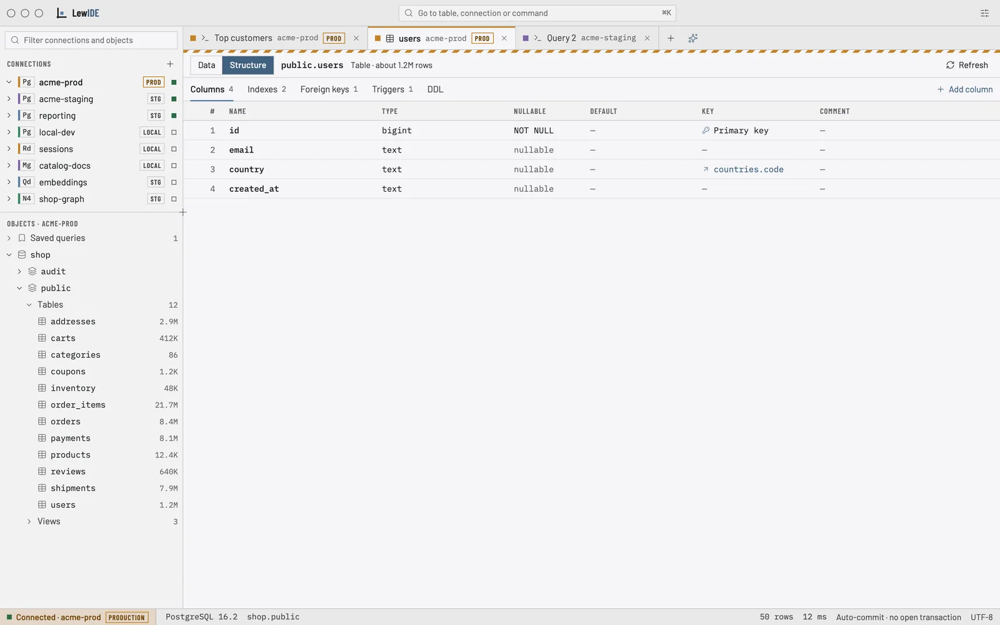
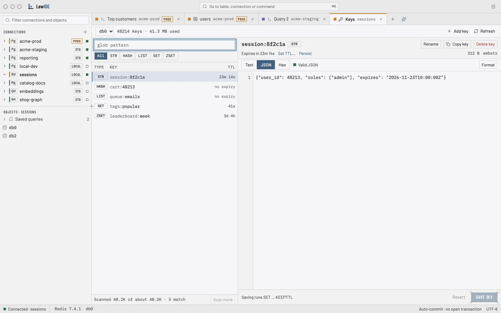
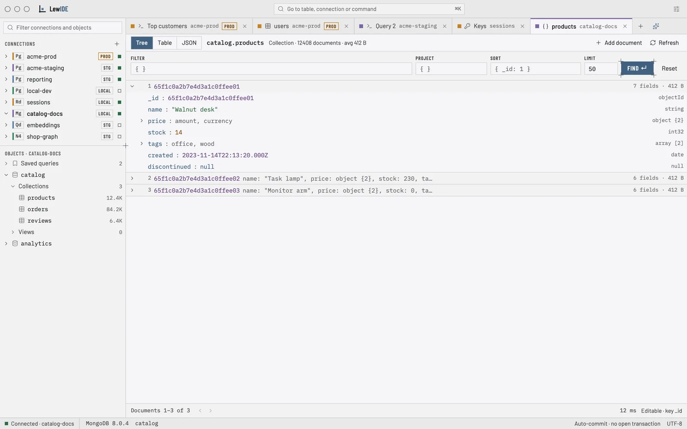
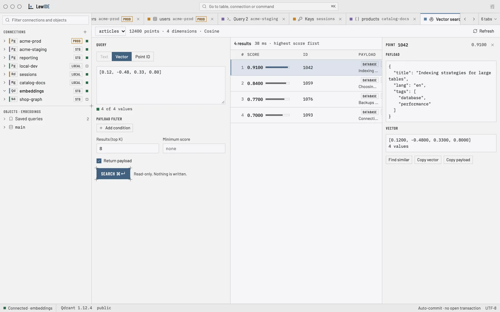
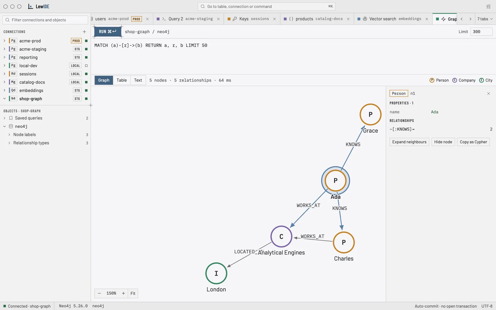

<div align="center">

<picture>
  <source media="(prefers-color-scheme: dark)" srcset="docs/assets/banner-dark.svg">
  
</picture>

<h3>One free, open-source app for every database you work with.</h3>

[](https://github.com/peritotr/lewide/actions/workflows/ci.yml)
[](#license)
[](#install)
[](https://tauri.app)
[](https://github.com/peritotr/lewide/stargazers)

[Features](#features) · [Databases](#supported-databases) · [Screenshots](#a-closer-look) · [Install](#install) · [Roadmap](ROADMAP.md) · [Contributing](CONTRIBUTING.md) · [Türkçe](README.tr.md)

</div>

**LewIDE** is a free, open-source **database client and SQL editor** for
macOS, Windows and Linux. It opens relational databases, document stores,
key-value stores, vector databases and graph databases in one fast desktop
app, with an **AI assistant that reads your schema but never your rows**. If
you have been switching between DBeaver, TablePlus, Navicat, DataGrip,
MongoDB Compass, RedisInsight, Neo4j Browser and Kibana Dev Tools, LewIDE puts them in one place.

<div align="center">
<picture>
  <source media="(prefers-color-scheme: dark)" srcset="docs/assets/demo-dark.webp">
  
</picture>
</div>

## Features

| | |
|---|---|
| 🗂️ **Every kind of database** | SQL, documents, key-value, vectors and graphs, each in a view made for it: a data grid, a document tree, a key browser, a vector search, a graph canvas. |
| ✍️ **A real SQL editor** | Highlighting and completion for your tables, run the statement under the cursor or all of them, errors pointed at the exact place, query plans, formatting, saved queries. |
| 🛡️ **Edits you can trust** | Changes stay pending until you apply them in one transaction, with the SQL shown first. A Production connection is marked everywhere and asks before every write. |
| 🧱 **Structure at a glance** | Columns, indexes, foreign keys (both ways), triggers and the DDL; change columns without writing ALTER TABLE by hand. |
| 🤖 **An AI that respects your data** | Explain, review and optimize queries with Anthropic, OpenAI, Gemini or any OpenAI-compatible server, Ollama included. Only table and column names are sent, and you can see exactly what. |
| 🔐 **Secure connections** | Passwords in the system keychain, never in a file. SSH tunnels and TLS for every network database. |
| 📦 **Import and export** | Import CSV, JSON and Excel with a column mapping, a preview and a report of the rows that did not fit; export to CSV, JSON, Excel or SQL. |
| 🌍 **Yours to use** | English and Turkish, light and dark themes, MIT / Apache-2.0. No account, no telemetry. |

## Supported databases

| | Database | What you get |
|---|---|---|
|  | PostgreSQL, CockroachDB, YugabyteDB | Data grid with editing, filters, structure and column changes, import, export, query plans |
|  | TimescaleDB | The same; hypertables open like tables |
|  | MySQL, MariaDB, TiDB | The same |
|  | SQLite | The same, on a local file |
|  | Microsoft SQL Server | Data grid with editing, structure and column changes, query plans |
|  | ClickHouse | Fast queries with cancel, structure, import |
|  | DuckDB | Built in, no server needed: data grid with editing, structure, import, export |
|  | Redis, Valkey | Key browser with editors for every core type |
|  | MongoDB | Documents as a tree, a table or JSON, edited in place |
|  | Qdrant | Vector similarity search with payload filters |
|  | Elasticsearch, OpenSearch | Search indices with Query DSL or query strings, edit documents, Dev Tools requests |
|  | pgvector | Vector search on PostgreSQL tables, with SQL beside it |
|  | Milvus | Vector similarity search with filters, named vectors |
|  | InfluxDB 3 | SQL over time series: read-only grid, tags and fields in the structure |
|  | Couchbase | Documents by bucket and collection, edited in place; SQL++ in query tabs |
|  | Neo4j | Cypher with a graph canvas, a table and text |

More are on the way: Oracle, Snowflake, BigQuery and others. See the [roadmap](ROADMAP.md).

## A closer look

<table>
<tr>
<td width="50%"><b>SQL editor and results</b><br><picture><source media="(prefers-color-scheme: dark)" srcset="docs/assets/screenshots/query-dark.webp"></picture></td>
<td width="50%"><b>AI assistant</b><br><picture><source media="(prefers-color-scheme: dark)" srcset="docs/assets/screenshots/ai-dark.webp"></picture></td>
</tr>
<tr>
<td><b>Table data</b><br><picture><source media="(prefers-color-scheme: dark)" srcset="docs/assets/screenshots/table-dark.webp"></picture></td>
<td><b>Table structure</b><br><picture><source media="(prefers-color-scheme: dark)" srcset="docs/assets/screenshots/structure-dark.webp"></picture></td>
</tr>
<tr>
<td><b>Redis keys</b><br><picture><source media="(prefers-color-scheme: dark)" srcset="docs/assets/screenshots/keys-dark.webp"></picture></td>
<td><b>MongoDB documents</b><br><picture><source media="(prefers-color-scheme: dark)" srcset="docs/assets/screenshots/documents-dark.webp"></picture></td>
</tr>
<tr>
<td><b>Vector search</b><br><picture><source media="(prefers-color-scheme: dark)" srcset="docs/assets/screenshots/vector-dark.webp"></picture></td>
<td><b>Graph</b><br><picture><source media="(prefers-color-scheme: dark)" srcset="docs/assets/screenshots/graph-dark.webp"></picture></td>
</tr>
</table>

## Install

Download the installer for your system from the
**[latest release](https://github.com/peritotr/lewide/releases/latest)**:

| System | File |
|---|---|
| macOS, Apple silicon (M1 and later) | `LewIDE_…_aarch64.dmg` |
| macOS, Intel | `LewIDE_…_x64.dmg` |
| Windows 10 and 11 | `LewIDE_…_x64-setup.exe` or `.msi` |
| Linux | `.AppImage` (any distribution), `.deb` (Debian, Ubuntu) or `.rpm` (Fedora, openSUSE) |

The installers are not signed with a paid developer certificate yet, so the
first launch shows a warning:

- **macOS:** open the app once, then go to System Settings → Privacy & Security and choose **Open Anyway**.
- **Windows:** SmartScreen says "Windows protected your PC"; choose **More info → Run anyway**.

⭐ Star or watch the repository to hear about new releases.

### Build from source

```bash
git clone https://github.com/peritotr/lewide.git
cd lewide
pnpm install
pnpm tauri build      # or `pnpm tauri dev` to run it straight away
```

You need [Rust](https://rustup.rs), [Node.js](https://nodejs.org) 22,
[pnpm](https://pnpm.io) and the [Tauri prerequisites](https://tauri.app/start/prerequisites/)
for your system. [CONTRIBUTING.md](CONTRIBUTING.md) has the details.

## Questions

**Is it free?** Yes, completely, under the MIT or Apache-2.0 licence. There is
no paid edition and no account.

**Does the AI assistant see my data?** No. It is sent the names and types of
your tables and columns, never the rows, and you can see what is sent before
it goes. You bring your own API key, or a local model through Ollama.

**Where are my passwords kept?** In your operating system's keychain
(Keychain on macOS, Credential Manager on Windows, the system keyring on Linux).

**Can it connect through SSH?** Yes, to every network database, with a
password or a key, and it checks the server's host key.

**Is it safe on a production database?** Mark the connection as Production:
the window shows it, and every change asks for confirmation first.

## Contributing

LewIDE is built in the open and contributions of every size are welcome: a
bug report, a translation, a new database driver. Start with
[CONTRIBUTING.md](CONTRIBUTING.md) and the [roadmap](ROADMAP.md).

## License

LewIDE is licensed under either of

- [Apache License, Version 2.0](LICENSE-APACHE)
- [MIT license](LICENSE-MIT)

at your option. Unless you state otherwise, any contribution you submit for
inclusion in LewIDE is licensed as above, without any additional terms.
