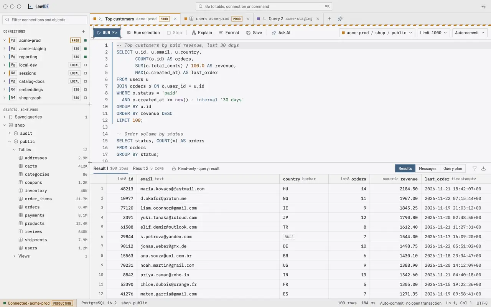

<div align="center">

<picture>
  <source media="(prefers-color-scheme: dark)" srcset="docs/assets/banner-dark.svg">
  
</picture>

<h3>Çalıştığın tüm veritabanları için tek, ücretsiz ve açık kaynaklı uygulama.</h3>

[](https://github.com/peritotr/lewide/actions/workflows/ci.yml)
[](#lisans)
[](#kurulum)
[](https://github.com/peritotr/lewide/stargazers)

[Özellikler](#özellikler) · [Veritabanları](#desteklenen-veritabanları) · [Kurulum](#kurulum) · [Yol haritası](ROADMAP.md) · [Katkı](CONTRIBUTING.md) · [English](README.md)

</div>

**LewIDE**, macOS, Windows ve Linux için ücretsiz ve açık kaynaklı bir
**veritabanı istemcisi ve SQL editörüdür**. İlişkisel veritabanlarını, doküman
depolarını, anahtar-değer depolarını, vektör ve graf veritabanlarını tek bir
hızlı masaüstü uygulamasında açar. İçindeki **yapay zekâ asistanı şemanı
okur, verini asla görmez**. DBeaver, TablePlus, Navicat, DataGrip, MongoDB
Compass, RedisInsight ve Neo4j Browser arasında gidip geliyorsan, LewIDE
hepsini tek yerde toplar.

<div align="center">
<picture>
  <source media="(prefers-color-scheme: dark)" srcset="docs/assets/demo-dark.webp">
  
</picture>
</div>

## Özellikler

| | |
|---|---|
| 🗂️ **Her tür veritabanı** | SQL, doküman, anahtar-değer, vektör ve graf; her biri kendine uygun bir görünümde: veri tablosu, doküman ağacı, anahtar tarayıcı, vektör araması, graf tuvali. |
| ✍️ **Gerçek bir SQL editörü** | Tablolarına göre renklendirme ve tamamlama, imleçteki ifadeyi ya da hepsini çalıştırma, hatanın tam yerini gösterme, sorgu planları, biçimlendirme, kayıtlı sorgular. |
| 🛡️ **Güvenle düzenleme** | Değişiklikler sen uygulayana kadar bekler ve tek transaction'da uygulanır; SQL önce gösterilir. Production bağlantısı her yerde işaretlidir ve her yazmadan önce onay ister. |
| 🧱 **Bir bakışta yapı** | Sütunlar, indeksler, iki yönlü yabancı anahtarlar, tetikleyiciler ve DDL; sütunları ALTER TABLE yazmadan değiştir. |
| 🤖 **Verine saygılı yapay zekâ** | Sorguları Anthropic, OpenAI, Gemini ya da Ollama dahil OpenAI uyumlu herhangi bir sunucuyla açıkla, incele, iyileştir. Yalnızca tablo ve sütun adları gönderilir; ne gittiğini görebilirsin. |
| 🔐 **Güvenli bağlantılar** | Parolalar dosyada değil, sistemin anahtar zincirinde. Her ağ veritabanı için SSH tüneli ve TLS. |
| 📦 **İçe ve dışa aktarma** | CSV ve JSON içe aktarma (sütun eşleme, önizleme, sığmayan satırların raporu); CSV, JSON ya da SQL olarak dışa aktarma. |
| 🌍 **Senin için** | Türkçe ve İngilizce, açık ve koyu tema, MIT / Apache-2.0. Hesap yok, telemetri yok. |

## Desteklenen veritabanları

PostgreSQL, CockroachDB, MySQL, MariaDB, SQLite, Microsoft SQL Server,
ClickHouse, DuckDB (sunucusuz, uygulamanın içinde), Redis, Valkey, MongoDB, Qdrant ve Neo4j.
Ayrıntılar için [İngilizce README](README.md#supported-databases), sıradakiler
için [yol haritası](ROADMAP.md).

## Kurulum

macOS, Windows ve Linux için hazır kurulum dosyaları ilk sürümle gelecek;
haberdar olmak için depoya ⭐ yıldız ver ya da izlemeye al. O zamana kadar
kaynaktan derleyebilirsin:

```bash
git clone https://github.com/peritotr/lewide.git
cd lewide
pnpm install
pnpm tauri build      # ya da hemen çalıştırmak için `pnpm tauri dev`
```

Gerekenler: [Rust](https://rustup.rs), [Node.js](https://nodejs.org) 22,
[pnpm](https://pnpm.io) ve sistemine göre [Tauri gereksinimleri](https://tauri.app/start/prerequisites/).
Ayrıntılar [CONTRIBUTING.md](CONTRIBUTING.md) dosyasında.

## Sık sorulanlar

**Ücretsiz mi?** Evet, tamamen; MIT veya Apache-2.0 lisanslı. Ücretli sürüm
ya da hesap yok.

**Yapay zekâ asistanı verimi görüyor mu?** Hayır. Yalnızca tablo ve sütunların
adları ve türleri gönderilir, satırlar asla; neyin gittiğini önceden
görebilirsin. Kendi API anahtarını ya da Ollama ile yerel bir modeli kullanırsın.

**Parolalarım nerede tutuluyor?** İşletim sisteminin anahtar zincirinde.

**Production veritabanında güvenli mi?** Bağlantıyı Production olarak işaretle:
pencere bunu gösterir ve her değişiklik önce onay ister.

## Lisans

LewIDE, tercihine göre [Apache License 2.0](LICENSE-APACHE) ya da
[MIT](LICENSE-MIT) lisansıyla kullanılabilir.
